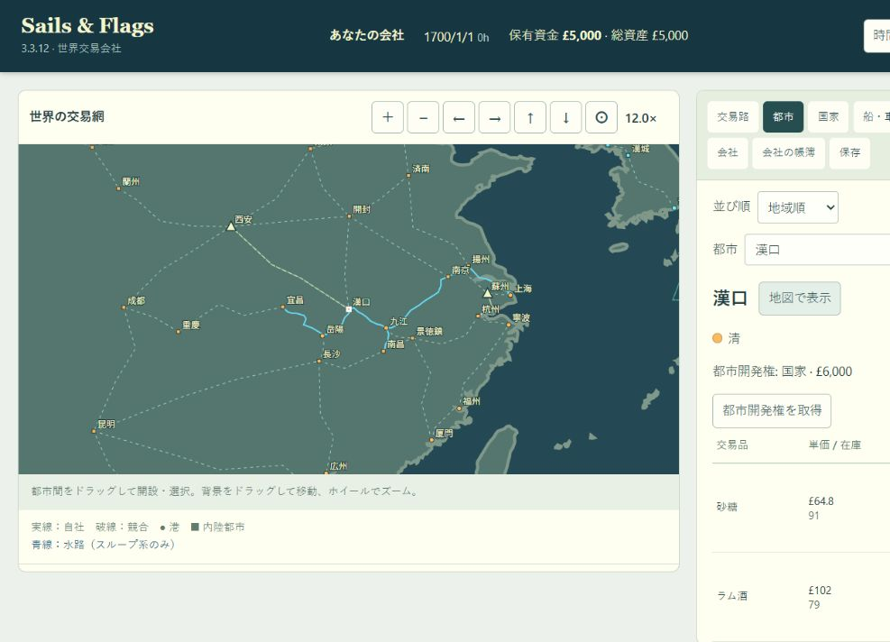
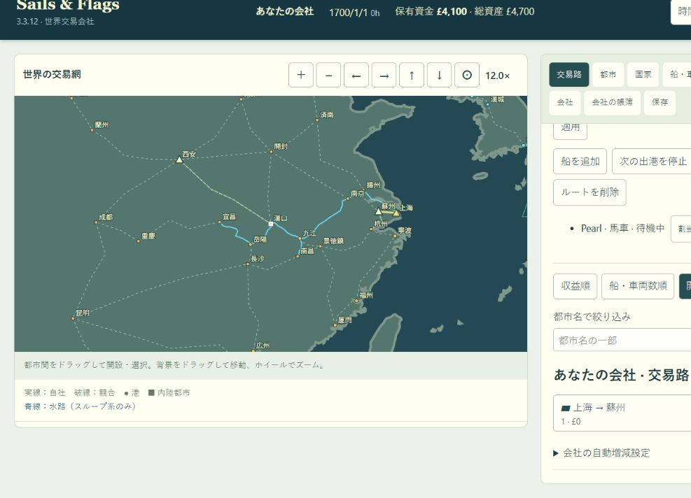

# 水路表示と上海–蘇州陸路（2026-10-13）

## 原因と対応

地理的な河道の点列をそのまま表示した結果、揚州への両方向の水路に共通の枝があり、九江から南昌へは湖口まで本流を戻ってから分岐していた。

距離・セーブ内の航行時間を変えず、表示用点列を別に生成する。揚州の両側の水路と九江の三方向の水路は、それぞれ都市点だけを共通点にする。都市表示位置の補正を経由都市にも適用し、基底水路・開設航路・船の移動で同じ線を使う。上海から沖合への基底線だけを非表示とし、実際の航路・外洋接続は残す。

上海–蘇州を100kmの平地陸路として末尾へ追加。内部保存版を29にし、版28は355道路として検証後に新しい道路状態だけを追加する。過去の内部版と都市・道路インデックスは維持する。

## 検証

修正前のWasmから、上海–宜昌を開設した内部版28の実セーブを作成して回帰テストに保存した。移行後に版番号と末尾道路を戻すと元のセーブと完全一致することを検証する。9水路の距離について修正前の値との厳密一致、表示分岐点、逆方向経路、上海–蘇州の往復開設も検証する。

## 実行結果

- Wasm再ビルド成功。上海–蘇州の表示端点を含む陸地検査も通過。
- 水路関連・Wasm境界の24テストを実行。初回23成功、北米の河川都市表示位置まで変わっていたため1失敗。表示位置の補正を長江に限定して修正し、影響するテストと新規回帰・バイナリ整合性の6テストを再実行、すべて成功。全体スイートは未実行。
- 変更JavaScriptと全テストファイルの構文検査、差分の空白検査が成功。
- ブラウザで最終ビルドを再読込し、揚州の一本線・九江からの分岐・上海沖合の基底線の非表示を目視確認。清の免許取得後、上海–蘇州を100km・馬車購入費£600で開設できた。警告・エラーログなし。
- 検証は別オリジンlocalhostの一時タブで実施。ユーザーの127.0.0.1のセーブとタブは変更していない。

