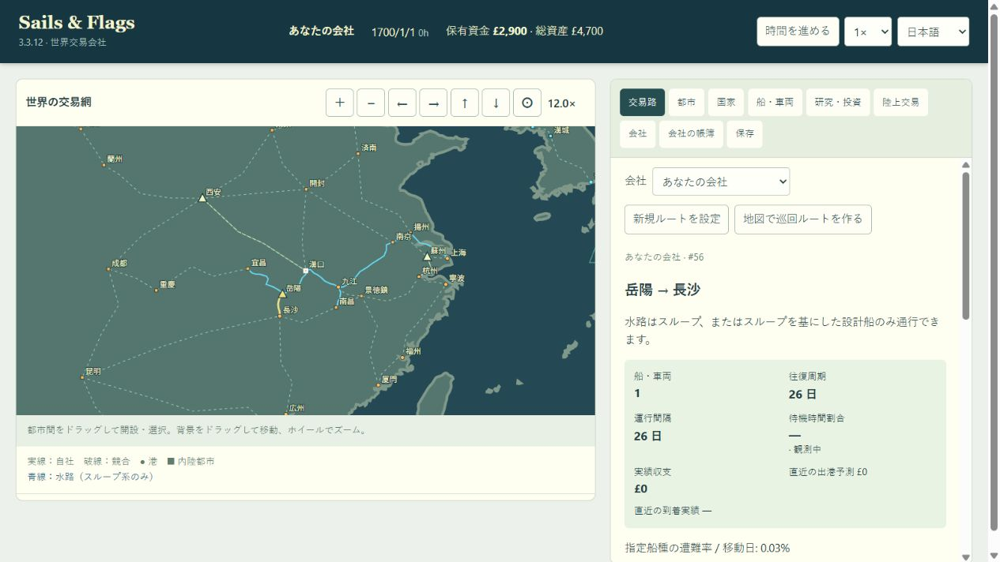

# 岳陽–長沙の水路転換

## 仕様

ユーザーの指定により、九江–南昌と同じ小型中国帆走商船の近似を適用する。岳陽から洞庭湖・湘江を経由して長沙に接続。水路はスループ系だけが利用でき、陸路の馬車・キャラバンは利用できなくなる。上海から海への常時表示線を消す方針は維持し、今回の枝は岳陽の都市点に接続する。新規ライブラリの追加なし。

## 保存

旧道路のインデックスを維持し、内部版30で廃止を記録する。版29の実バイナリで、積荷を積んだ移動中のキャラバン、道路開発権と投資残高、無関係の上海–蘇州陸路と上海–宜昌水路を持つ保存を生成した。移行時の車両保持、解除、返金、再読込時の不変性、不正値を除去前に拒否することを回帰テストで確認する。

## 検証

- Wasmビルド成功。323都市・356道路スロット・330有効陸路・10水路。岳陽–長沙の水路距離は約79.4海里。
- 関連20テストがすべて成功（長江、水路接続、旧試作版を含む保存移行、Wasm境界）。全体スイートは未実行。
- 岳陽–長沙の往復はスループのみ、スループ設計船は選択可、大型船・陸上車両は不可。寧波–長沙の90日間輸送で配送と航行中の保存復元を確認。
- 旧29保存の返金は積荷原価＋道路権取得費＋未使用投資残高。車両は維持し、無関係の船・ルート・市場・都市投資・乱数状態を保持。不正値拒否、道路権再取得・再投資の禁止、再読込で返金が重複しないことを確認。
- 変更JavaScriptの構文検査と差分空白検査が成功。
- ブラウザの別オリジンlocalhostで、岳陽の点から長沙への分岐、スループだけの選択、購入費£1,800での開設を確認。警告・エラーログなし。ユーザーの127.0.0.1のタブ・保存には変更なし。

