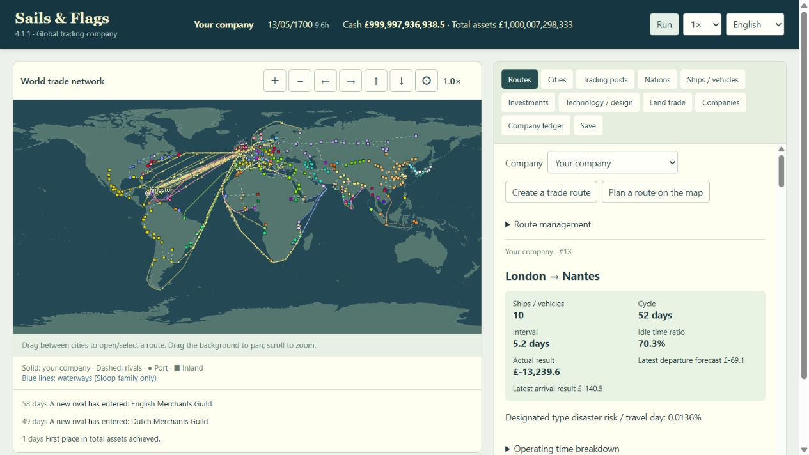

# 実行時性能改善 — 2026-10-20

## 対象と方針

4.1.1 (`efbb57dbb4478320ccfc6cea691d5d001631c984`) を比較元に、進行後の重さを調査した。ゲームルール、乱数順序、保存形式、版番号は変更しない。検証はローカルのみで行い、GitHub・Sitesへの反映は行わない。

既にWasmは描画とは別のWorkerで動作していた。会社同士が市場在庫・価格・乱数を共有するため、会社ごとにWorkerへ分散するだけでは結果が変わる。今回は不要な計算・転送・描画を削減し、独立した保存処理を別Workerへ移した。

## 測定

AMD Ryzen AI 5 PRO 340 / Radeon 840M、論理12 CPU。旧Threadripper実機では測定していない。固定シード1700、初期60経路・600隻、180日後は全社合計138経路・687隻。計測用に資金・免許・技術を十分に持たせた負荷試験であり、通常の経営バランス試験ではない。

最後の比較はブラウザ検証を閉じ、比較対象の測定を順番に実行した。計測は1回の実行内で日次180回、各view30回、save10回。OSのスケジューリングやCPU電力制御による変動を含み、統計的な速度保証ではない。

| 対象 | 4.1.1 | 改善後 |
| --- | ---: | ---: |
| 日次処理の平均 | 2.152 ms | 2.034 ms |
| 進行後の通常画面データ生成 | 14.852 ms（全情報） | 10.559 ms（runtimeView、選択経路1件） |
| 進行後の完全なview生成（比較用API） | 14.852 ms | 15.154 ms |
| 通常画面データ量 | 654,358 bytes | 551,289 bytes |
| 日内の時計だけの取得 | 全viewを生成 | 0.00354 ms |
| 保存文字列生成の平均 | 5.397 ms | 5.610 ms |

主な改善は表示準備の約29%削減と、同日内の更新で全viewを作らなくなった点。日次シミュレーションの差は小さく、大幅に速くなったとは評価しない。保存文字列の生成自体も高速化していない。その後の文字コード変換・IndexedDB保存を別スレッドで進める。

ブラウザで600隻の描画命令を送る処理を100回測定し、WebGL平均0.091 ms、SVG平均0.311 msだった。毎回fractionを変えて、同一フレーム省略が計測を短絡しないようにした。これはCPU側の描画命令送出時間であり、GPU完了時間・画面全体のFPSではない。ブラウザのドライバー実装次第でWebGLがソフトウェア描画となる場合もある。

生データ: [runtime-benchmark.json](2026-10-20-runtime-benchmark.json)。

## 実装・発見事項

- `movement.rs` / `trade.rs` / `view.rs`: 経路ごとの全船走査を索引に置換し、出発位相も一度計算する。船を処理する順序・浮動小数点計算順序は維持した。
- `simulation.rs`: 日次処理で季節係数と都市ごとの需要倍率を使い回す。
- `runtimeView`: 選択経路の詳細だけを計算する。経路形状は都市列・交通種別が変わった場合のみ再送する。完全な`view`は互換APIとして維持。
- UIの言語切替は地図を作り直すため、前回受信した経路形状をUI側で保持する必要があった。これを追加し、再構築で経路・船が消えないことを確認した。
- 選択変更と進行応答が交差した場合、選択経路の詳細をまだ受信していない瞬間がある。フォームを未定義配列で描画しないようにした。
- 保存Workerが起動できない場合、読取は既存IndexedDB実装で再試行する。書込は完了有無が不明なため自動再実行せず通知する。これにより保存読取の一時的なWorker障害で既存ゲームを見落とすことを避ける。
- 初回テストでは手作りfixtureの現金だけを変更して会計整合性検証に拒否された。初期資金も同額へそろえて修正した。保存Workerの読取再試行へ変更した際、走行中テストが旧期待値を読み込んで1件失敗したため、最終状態で再実行した。
- GPU非対応・context lost時はSVGへ戻す。都市・名前・経路の選択処理はGPUへ移していない。

## 検証

- 比較元Wasmと最終Wasmで、通常ゲーム（イベントあり）・600隻fixtureを各360日進行。30日ごとにセーブ文字列と完全なviewを比較し、全て一致した。
- Rustテスト9件成功。
- 最終の関連Nodeテスト99件成功（約134秒）。性能回帰、翻訳、IndexedDB、Wasm境界・ビルド整合性、都市選択、Wasmコア、経路管理、商館を対象とした。全カタログを含む`npm test`全体は今回は実行していない。変更JSの構文検査と`git diff --check`も成功。
- ローカルブラウザ（専用ポート4197）: 600隻のWebGL描画、進行後644隻の表示、ズーム・移動、強制SVG切替、保存WorkerによるIndexedDB往復の内容一致、60日進行中の自動保存と手動保存完了を確認。
- 実際のゲーム画面でも大規模保存から起動し、経路選択時の候補船種、言語変更後の経路形状、日内更新・日次更新・保存を含む進行を確認した。
- [構成と再現手順](../Documents/RuntimePerformance.md)、`tests/runtime-performance.test.js`、`tests/runtime-browser.html`、`scripts/benchmark-runtime.mjs`を追加。

## 残る制約

- Wasmの日次ゲーム処理は1スレッド。GPU上で経済・AIを計算する方式には変更していない。
- 大規模な保存文字列・viewの生成、日次のパネル全体再描画、船の配列移動や在庫検索、AIの経路候補探索などは引き続き調査候補となる。特に非常に大きな船団の配列移動は今回変更していない。
- SharedArrayBufferを使うWasm並列化は配信ヘッダーと状態更新設計の変更が必要。公開先の設定変更は今回行っていない。
- 実際に遅くなったユーザーのセーブと旧Threadripperでの効果は未測定。今回の数字を全ての環境・ゲーム規模へ一般化しない。
